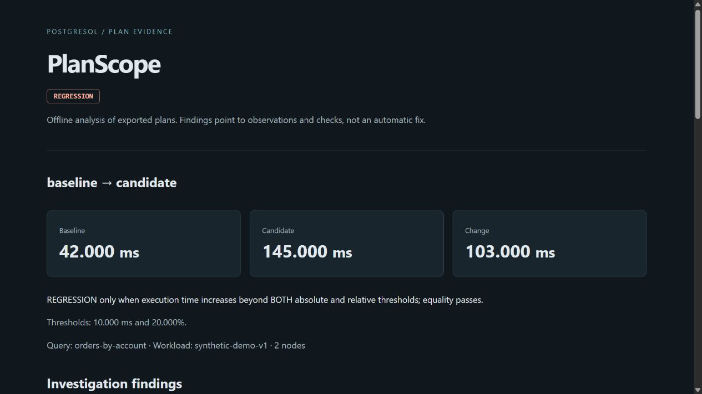

# PlanScope

[](https://github.com/Almeida96/planscope/actions/workflows/ci.yml)

Compare exported PostgreSQL execution plans with evidence you can inspect. PlanScope keeps named captures in a local SQLite database, flags six kinds of observed behavior, and produces JSON, Markdown or a standalone HTML report. A read-only MCP server exposes the same captures to an agent.

It runs offline with Java 21 or later. It does not connect to PostgreSQL, execute SQL, call a model, or require API keys.

## Try the example

Download `planscope-0.1.0.zip` and `SHA256SUMS` from [Releases](https://github.com/Almeida96/planscope/releases), verify the checksum, and extract the archive. Set `JAVA_HOME` to a Java 21+ installation, or put its `java` executable on `PATH`.

From the extracted directory:

```sh
bin/planscope demo --dir demo
```

On Windows PowerShell:

```powershell
.\bin\planscope.bat demo --dir demo
```

Open `demo/comparison.html`. The synthetic baseline records **42 ms**, the candidate **145 ms**: a 103 ms increase, about 245%. The candidate triggers three review findings: a disk sort, a 100× row-estimate difference and a filter removing 98% of incoming rows.

These are authored fixtures, not measured benchmark results. The demo exits `0` after writing its artifacts, even though its comparison is `REGRESSION`. The destination directory must be new; its parent must already exist. It contains the two input files, `plans.db`, comparison reports in three formats and `analysis.json`.



## Use your own captures

Export one statement with `EXPLAIN (ANALYZE, BUFFERS, FORMAT JSON)`. `ANALYZE` executes the statement on the database where you capture it; review the [capture guide](docs/capture-guide.md) before running it. PlanScope itself only reads the exported file.

The following commands assume the distribution's `bin` directory is on `PATH`. On Windows, use `planscope.bat`.

```sh
planscope import --db plans.db --file before.json --name before --query orders-by-account --workload staging-v3-warm
planscope import --db plans.db --file after.json --name after --query orders-by-account --workload staging-v3-warm
planscope list --db plans.db
planscope analyze --db plans.db --plan after --format html --out after.html
planscope compare --db plans.db --baseline before --candidate after --format html --out comparison.html
```

An import name is immutable: importing identical bytes and labels again returns the same capture; different content or context requires a new name. Inspect by name or full capture ID. `--out` requires a new file and does not create parent directories. Omit it to write the report to stdout. `list` uses JSON; `analyze` and `compare` accept `json` (default), `md` or `html`.

Choose the same `--query` and `--workload` labels only when the captures are comparable. PlanScope checks label equality; it cannot verify equivalent SQL, parameters, data, configuration, hardware or cache state.

## Understand a comparison

A comparison reports `REGRESSION` only when the execution-time increase exceeds **both** thresholds: 10 ms and 20% by default. Equality passes. Override them with `--max-increase-ms` and `--max-increase-percent`.

| Exit code | Meaning |
| --- | --- |
| `0` | Command completed; comparison passed the selected thresholds |
| `1` | Invalid arguments, invalid input, storage or file error |
| `2` | Comparison reports `REGRESSION` |
| `3` | Comparison reports `INCONCLUSIVE` |

Different labels, the same capture on both sides, missing execution observations or a zero baseline time make the comparison inconclusive. A passing threshold check is not proof of query efficiency or release safety. Repeat measurements under controlled conditions before drawing a performance conclusion.

Findings contain a rule ID, observed metrics, a next check and a JSON pointer such as `/0/Plan/Plans/0`. Nodes match across captures only when the pointer and identity of every ancestor match. Reordered or replaced nodes remain unmatched. Read [rules and interpretation](docs/rules.md) for the precise triggers and limitations.

## Work with an agent

```sh
planscope mcp --db plans.db
```

The stdio server opens the selected database read-only and offers `list_plans`, `analyze_plan`, `inspect_node` and `compare_plans`. Tools cannot import captures, open other file paths or run SQL. See [agent setup and workflow](docs/agent-workflow.md) for client configuration, Windows notes and an evidence-based review sequence.

## Data and limits

Inputs must be UTF-8 PostgreSQL JSON: one array containing one statement, with a `Plan` tree. Each capture is limited to 8 MiB, 5,000 nodes and plan depth 48. Plain estimated plans are accepted; execution rules need observed counters. See the [capture guide](docs/capture-guide.md) for format details.

The SQLite database retains the original input bytes, including any predicates or literals in that file. Reports and MCP omit SQL text, predicates and output expressions, but retain names, labels and selected metrics. Review those names before sharing reports; keep the database according to the sensitivity of the original capture.

HTML reports embed their styles and evidence and need no server or external assets. PlanScope does not generate SQL fixes, recommend indexes automatically or analyze parallel-worker detail, JIT, triggers, incremental-sort groups or remote execution detail.

## Build and check

A JDK 21 installation is required to build. The Gradle wrapper downloads the build tooling and dependencies on first use; the installed application runs offline afterward.

```sh
./gradlew test installDist distZip --no-daemon --console=plain
build/install/planscope/bin/planscope demo --dir build/demo
python checks/cli_smoke.py build/install/planscope
```

Use `.\gradlew.bat` and `.\build\install\planscope\bin\planscope.bat` in PowerShell. CI tests Java 21 on Ubuntu and Windows, exercises the installed CLI and the official Python MCP client, and builds the distribution ZIP. A separate PostgreSQL 18 job captures and analyzes real plans for filtering, disk sorting, estimated-only output and `TIMING OFF`. Release publication requires all three jobs to pass. See [Contributing](CONTRIBUTING.md), [architecture](docs/architecture.md) and [release notes](docs/release.md).

[Changelog](CHANGELOG.md) · [MIT license](LICENSE)
